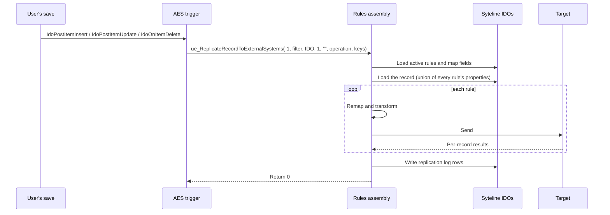

# Architecture

This page is for developers. It describes the parts of the system and how a record gets from a save to a target.

## Parts

Everything uses the `AIR` prefix, on IDO server `ue_AIR`.

| Layer | Objects |
| --- | --- |
| Tables | Six `ue_AIR_idorepl_*_mst` tables, the replication queue among them, each with a view of the same name without `_mst`. The IDOs bind to the views. |
| IDOs | `ue_AIR_IDOReplicationRules`, `ue_AIR_IDOReplicationCredentials`, `ue_AIR_IDOReplicationMapFields`, `ue_AIR_IDOReplicationMapFieldSources`, `ue_AIR_IDOReplicationLogs`, `ue_AIR_IDOReplicationConfigs` (extends `IdoCollections`), `ue_AIR_EventHandlers` (extends `EventHandlers`) |
| Extension class assemblies | `ue_AIR_IDOReplicationRules_ECA` (replication, logging, retries) and `ue_AIR_IDOReplicationConfig_ECA` (trigger setup). .NET Framework 4.8. |
| Forms | `ue_AIR_IDOReplicationConfigs`, `ue_AIR_IDOReplicationRules`, `ue_AIR_IDOReplicationCredentials`, plus the Import Map windows |

## IDO methods

| IDO | Method | Purpose |
| --- | --- | --- |
| `ue_AIR_IDOReplicationRules` | `ue_ReplicateRecordToExternalSystems(BGTaskNum, queryFilter, IDOName, recordCap, ruleNum, operation, keyValues)` | The entry point. Called by triggers, which also pass the record's keys, and by the bulk-load background task. A trigger run queues the change for rules with Use Queue on and sends it for the others. |
| `ue_AIR_IDOReplicationRules` | `ue_SendQueuedReplications(BGTaskNum)` | The [replication queue](Replication-Queue)'s sender, a scheduled background task |
| `ue_AIR_IDOReplicationRules` | `ue_RetryFailedReplications(BGTaskNum, purgeAfterDays)` | The retry and purge background task |
| `ue_AIR_IDOReplicationRules` | `ue_LoadOutputPreview(ruleNum, IDOName, queryFilter)` | Custom load method that returns up to 5 remapped records for a rule |
| `ue_AIR_IDOReplicationConfigs` | `ue_UpdateAESTriggers(idoName, action, ref results)` | `SetupTriggers`, `RemoveTriggers`, `FixTriggers`, `ActivateAllTriggers`, `DeactivateAllTriggers` |

A method's name in the IDO must match the C# method name exactly, `ue_` prefix included.

## The replication flow

1. **Entry.** `ue_ReplicateRecordToExternalSystems` normalizes the operation (`Insert`, `Update` or `Delete`, and `Upsert` for anything else) and works out the run's source and wraps everything in a try/catch. It always returns 0.
2. **Rules.** `LoadReplicationRulesAndMaps` loads the IDO's active rules, with their credential values and options, and each rule's map fields. With no active rules it stops.
3. **Records.** `LoadSourceRecords` loads the union of every rule's source properties once through `SytelineInternalAPI.LoadRecords`. If that load fails, it loads each rule's records separately, so only the rule that can't be loaded fails. All data access goes through IDOs, not direct SQL.
4. **Per rule.** `ReplicateRule` calls `RemapRecords` to build the output records and apply transformations, then `SendRule` to send them. Each rule is isolated: an exception becomes a failed `ReplicationRuleResult`, and the other rules still run.
5. **Sending.** `SendRule` switches on `TargetType`:
   - `AzureEventHub`: `AzureEventHubPusher.Push`
   - `SalesforceRESTAPI`: `SalesforceRestAPI.UpsertRecords`, or `DeleteRecords` for a delete when the rule allows it
   - `LogOnly`: sends nothing. It waits for the rule's DelayMilliseconds, then logs every record as `Succeeded`, or as `Failed` when the rule's SimulatedResult is `Failed`
6. **Outcomes.** Each record gets a `ReplicationRecordOutcome` (status, error, warning, payload).
7. **Logging.** `WriteReplicationLog` inserts the outcomes into `ue_AIR_IDOReplicationLogs` in groups of 200. It never throws.

## The never-throw rule

Replication runs inside the user's save. An unhandled exception would fail the event action and roll back the save. So every path catches its errors and turns them into a rule result or a log row. Keep that true in new code.

## Credential values and options

A rule carries ten credential values (from its linked credential) and ten options. What each position means depends on the target type, and it is defined in three places that must agree. The Rules form doesn't show credential values, only which credential a rule uses:

| Place | What it defines |
| --- | --- |
| The Credentials form's `UpdateValueLabels` script | Credential value labels |
| The Rules form's `UpdateVariableUI` script | Option labels |
| `SendRule` in the Rules assembly | Which position is read for what |

| Target type | Credential values | Options |
| --- | --- | --- |
| `AzureEventHub` | 01 ConnectionString, 02 EventSource, 03 MaxBatchKBOverride | 01 EventSchemaUri, 02 UpsertFieldName (the ID field), 03 OperationFieldName |
| `SalesforceRESTAPI` | 01 ClientId, 02 ClientSecret, 03 Domain | 01 DestinationName (sObject), 02 ExternalIDFieldName, 03 DeleteBehavior |
| `LogOnly` | none | 01 DelayMilliseconds, 02 RecordIDFieldName, 03 SimulatedResult |

## Triggers

`SetupTriggers` in the Config assembly inserts `EventHandlers` rows (description `ue_AIR_ReplicationTrigger`) for `IdoPostItemInsert`, `IdoPostItemUpdate` and `IdoOnItemDelete`, then one `EventActions` row for each. It also inserts and deletes a temporary `CustomAIR` handler to work around a sequencing problem when several handlers are inserted at once. The handlers are created inactive.

`FixTriggers` reads which handlers are active, removes them all, calls `SetupTriggers`, and then activates the ones that were active before. The method isn't transactional, so a failure partway leaves what was already done. It throws in that case, and the error says what was done and what to click next.

`ue_UpdateAESTriggers` returns 0 when the action worked and 1 when it didn't, and puts a message that says what it did in `results`. The form binds `results` to the variable `ResultsByRef`.

The Configs form reads two status properties on `ue_AIR_IDOReplicationConfigs`:
- `ue_EventHandlersStatus` (`Not Setup`, `Setup`, `Broken`) decides which buttons show. The form keeps it loaded through a hidden grid column.
- `ue_EventHandlersStatusDetail` (`Not Setup`, `Active`, `Inactive`, `Partly Active`, `Broken`) is the status the form displays, in the detail area and as a grid column. It counts the active handlers in the `EventHandler` table.

The action's `Parameters` string is compared exactly by two derived properties:
- `ue_AIR_IDOReplicationConfigs.ue_EventHandlersAreSetup` (drives the Setup or Broken status)
- `ue_AIR_EventHandlers.ue_IsSetup`

Any change to that string in `SetupTriggers` must be made in both expressions too, and existing triggers then need **Fix Triggers**.

## Transformations

Defined in `Models/ReplicationFieldTransformTypes.cs`. Each takes the typed value the IDO returns and returns the value to send. Nulls stay null. A value that can't be converted is sent unchanged with a warning. The `Value` strings must match the `SourceTransformation` inline list on the `ue_AIR_IDOReplicationMapFields` IDO.

## The log and retries

See [Replication Log and Retries](Replication-Log-and-Retries) for behavior. In code: `WriteReplicationLog` and `BuildLogRow` write rows, `RetryFailedReplications` resends them through the same `SendRule`, `FindSupersededLogRows` finds failed rows that a newer replication replaced, and `PurgeReplicationLog` deletes old rows.
