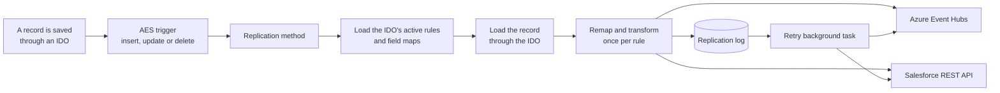

# AES-Driven IDO-Layer Data Replication

> [!CAUTION]
> This project is in pre-beta testing and is shared for collaboration. Use at your own risk.

Event-driven data replication for Infor CloudSuite Industrial (Syteline), built on the Mongoose framework. An administrator sets up replication rules in Syteline forms. When a record is inserted, updated or deleted through an IDO, the record is remapped and sent to an external system.

## How it works

1. **Triggers.** On the IDO Replication Configs form you set up triggers on an IDO. This creates Application Event System (AES) event handlers for insert, update and delete.
2. **Rules.** Each trigger calls the replication method, which loads the IDO's active rules, reads the record through the IDO layer, and builds one output record per rule from the rule's field map.
3. **Sending.** Each rule sends its output record to its target with its credential.
4. **Logging and retries.** Each record's outcome goes to the replication log. A scheduled background task resends failed records.

Replication errors don't fail the user's save. Every error is caught and written to the replication log. The one exception seen in testing: for a few minutes after an assembly is uploaded, a save can fail because Syteline can't load the extension class (see [Upgrading](Installation#upgrading)).

## Targets

| Target | Status |
| --- | --- |
| [Azure Event Hubs](Target-Azure-Event-Hubs), including Microsoft Fabric Eventstreams | Working |
| [Salesforce REST API](Target-Salesforce) | Working |
| Other Syteline instances, SQL databases, other ERP systems | Not started |

## Pages

**Setting up**
- [Installation](Installation)
- [Credentials](Credentials)
- [Replication Rules and Field Maps](Replication-Rules-and-Field-Maps)
- [Setting Up Triggers](Setting-Up-Triggers)

**Targets**
- [Azure Event Hubs](Target-Azure-Event-Hubs)
- [Salesforce](Target-Salesforce)

**Running it**
- [Replication Log and Retries](Replication-Log-and-Retries)
- [Bulk Loads](Bulk-Loads)
- [Troubleshooting and Limitations](Troubleshooting-and-Limitations)

**For developers**
- [Architecture](Architecture)
- [Development](Development)

## Quick start

1. [Install](Installation) the package from `dist/`.
2. Add a [credential](Credentials) for your target.
3. Add a [rule](Replication-Rules-and-Field-Maps) for the IDO you want to replicate, with a field map, and mark it active.
4. [Set up triggers](Setting-Up-Triggers) on that IDO, then activate them.
5. Save a record and check the [replication log](Replication-Log-and-Retries).

## License

MIT. See `LICENSE` in the repository.
